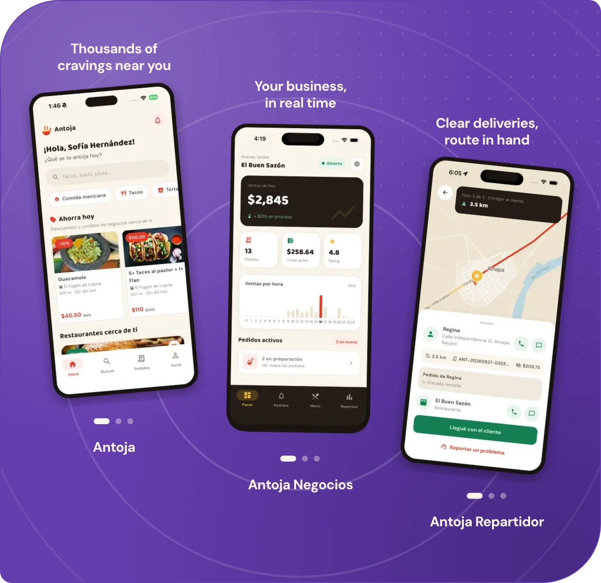
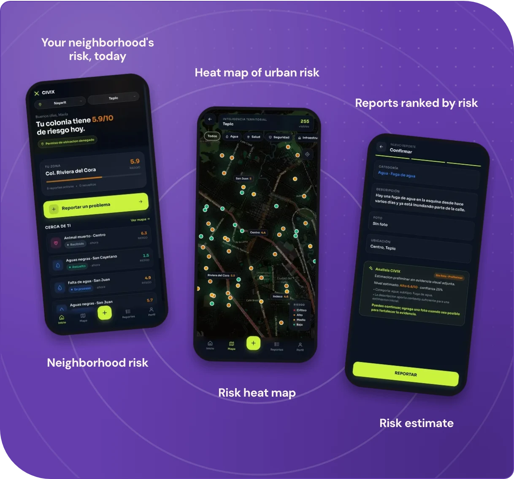
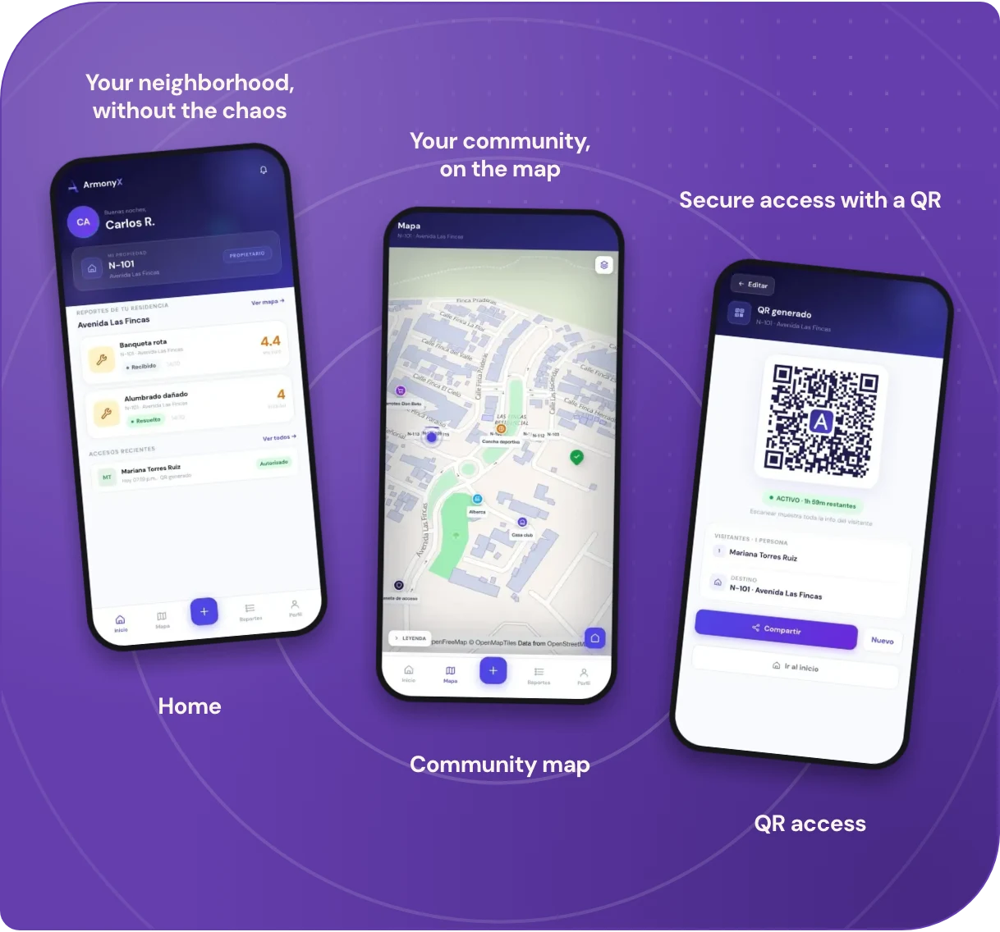
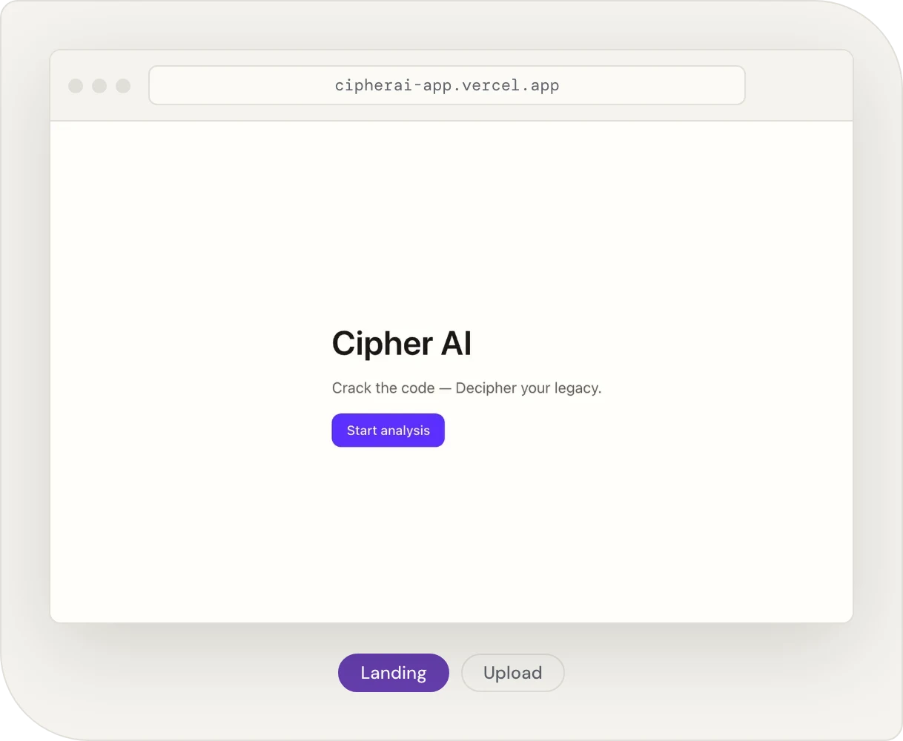

 

 
 

 

## About

I build web and mobile products end to end with Flutter, Next.js and Node.js, taking features from the database to the screen. Most recently as founder and lead of **Antoja**, a three-app food delivery platform for Santiago Ixcuintla and Tuxpan, Nayarit, and as tech lead of **ArmonyX**, a SaaS for private residential communities. Before that, **CiviX**, a civic-tech platform that turns citizen reports into urban risk intelligence, and **Cipher AI**, built for the Gemini 3 Hackathon. My portfolio is available in English and Spanish.

| Focus | Core stack | Currently |
| :--- | :--- | :--- |
| Web & mobile products | Flutter · Next.js · Node.js | Building Antoja & ArmonyX |

 

## 01 / Experience

**Honda Avante** · Tepic, Nayarit
Internship, Development department · *May – August 2025*

### Education

**Universidad Tecnológica de la Costa**

- Software Development and Management Engineering · *In progress, expected April 2027*
- TSU in Information Technologies, Multiplatform Software Development · *Completed*

 

## 02 / Expertise

| | |
| :--- | :--- |
| **Mobile Development** | Cross-platform apps from a single codebase, shipped for multiple user roles. |
| **Web Development** | Responsive, performant web applications and landing pages. |
| **Backend & Data** | APIs, relational data models and third-party integrations such as payments and push notifications. |
| **Interface Design** | UI and UX designed in Figma and built with component libraries. |
| **Cloud & Delivery** | Hosting and deployment in the cloud. |
| **Architecture** | System design, scalability and performance optimization. |

### Languages & technologies

**Languages** 

**Frameworks** 

**Interface** 
 
Also shadcn/ui and Framer Motion

**Databases** 

**Cloud & integrations** 
 
Also Mercado Pago and Google APIs

### Strengths

| | |
| :--- | :--- |
| **Leadership** | Led Antoja from the first idea and acted as technical lead on ArmonyX and CiviX. |
| **Ownership** | Takes a feature from the database to the screen and stays with it until it ships. |
| **Product mindset** | Starts from the user's problem and designs the interface before writing the code. |
| **Fast learner** | Moves between Flutter, Next.js, Node.js and AI APIs and becomes productive quickly. |
| **Teamwork** | Comfortable in a development team, as at Honda Avante, and good at explaining technical decisions. |
| **Under pressure** | Delivers on tight deadlines: a hackathon build and a state science fair that led to a national stage. |

 

## 03 / Selected work

### Antoja

> Food delivery platform for Santiago Ixcuintla and Tuxpan, Nayarit, the first service of its kind in both towns. Three Flutter apps (for customers, restaurants and couriers) share one codebase and a Node.js backend.

  
   
  On the <a href="https://dev-frame.vercel.app">portfolio</a> each app is a carousel with all of its screens.

**Role:** Founder & project lead

- Came up with the idea and lead the project end to end
- Designed the UI and UX of all three apps
- Integrated Google APIs and Firebase push notifications
- Built online payments with Mercado Pago

`Flutter` `Dart` `Node.js` `Firebase` `Mercado Pago` `Google APIs` · [**antoja.com.mx**](https://antoja.com.mx)

### CiviX

> A progressive web app that turns citizen reports into territorial intelligence. Every report gets a transparent urban risk index, so municipal teams attend what is most critical first, not what arrived last.

  

**Role:** Tech lead & backend developer

- Accredited to the national ExpoCiencias 2026 in Monterrey after the Nayarit state fair
- Led the technical direction and designed the interfaces
- Transparent urban risk index that ranks reports by impact, not by date
- Duplicate detection that merges nearby reports and lets neighbors add support
- Admin heat map and crisis simulator, with real-time updates over Socket.IO and Web Push

`Next.js` `TypeScript` `Express` `Prisma` `PostgreSQL` `Leaflet` `Socket.IO` `PWA`

### ArmonyX

> A platform for managing private residential communities in Mexico. Administrators, residents and guards work on the same real-time system instead of WhatsApp groups, paper logs and spreadsheets.

  

**Role:** Tech lead & backend developer

- Led the technical direction and designed the interfaces
- Incident reports with photo and map pin, validated by AI and scored for risk
- QR access for visitors and couriers, scanned by guards at the gate
- Multi-tenant Express and PostgreSQL backend with real-time updates over Socket.IO
- Interactive map of the community built with MapLibre GL

`Next.js` `TypeScript` `Express` `Prisma` `PostgreSQL` `Socket.IO` `MapLibre GL` · [**armony-x.vercel.app**](https://armony-x.vercel.app)

### Cipher AI

> Transform legacy code into documented, secured, maintainable software in 30 seconds using Gemini 3's structured reasoning.

  

**Role:** Developer · Built for the Gemini 3 Hackathon

`Next.js` `TypeScript` `React` `Tailwind` `Google Gemini 3` `Redis` · [**Live site**](https://cipherai-app.vercel.app/) · [**Code**](https://github.com/Dashxl/Cipher-AI)

### More projects

| Project | What it is | Stack |
| :--- | :--- | :--- |
| [**SecureDesk**](https://github.com/Dashxl/SecureDesk) · [live](https://secure-desk-app.vercel.app) | A corporate AI agent that acts on a user's behalf across Slack and Gmail, with credentials in Auth0 Token Vault, approval for sensitive actions and an audit trail. | Next.js, TypeScript, Auth0, AI SDK |
| [**DevFrame**](https://github.com/Dashxl/DevFrame) · [live](https://dev-frame.vercel.app) | My portfolio: a minimal, accessible site with light and dark themes. | Next.js, Tailwind CSS, Framer Motion |
| [**Snack Factory**](https://github.com/Dashxl/Snack-Factory) · [live](https://snack-factory.vercel.app) | A phone-first digital menu for a crepe and drinks shop. | React, TypeScript, Vite |

 

## GitHub stats

<a href="https://github.com/Dashxl">
  <picture>
    <source media="(prefers-color-scheme: dark)" srcset="https://streak-stats.demolab.com/?user=Dashxl&hide_border=true&background=00000000&ring=B79CED&fire=B79CED&currStreakNum=FFFFFF&sideNums=FFFFFF&currStreakLabel=B79CED&sideLabels=C9C9D1&dates=8B8B99" />
    <source media="(prefers-color-scheme: light)" srcset="https://streak-stats.demolab.com/?user=Dashxl&hide_border=true&background=00000000&ring=6A40B0&fire=6A40B0&currStreakNum=1D1B22&sideNums=1D1B22&currStreakLabel=6A40B0&sideLabels=6B6872&dates=6B6872" />
    
  </picture>
</a>

 

<picture>
  <source media="(prefers-color-scheme: dark)" srcset="https://github-readme-stats.vercel.app/api/top-langs/?username=Dashxl&layout=compact&hide_border=true&bg_color=00000000&title_color=B79CED&text_color=C9C9D1" />
  <source media="(prefers-color-scheme: light)" srcset="https://github-readme-stats.vercel.app/api/top-langs/?username=Dashxl&layout=compact&hide_border=true&bg_color=00000000&title_color=6A40B0&text_color=1D1B22" />
  
</picture>

 

## 04 / Contact

### Hiring? Let's talk.

I'm looking for a team where I can build web and mobile products end to end. If you have a role or a project in mind, I'd like to hear about it.

**[sandro.ramirez.1102@gmail.com](mailto:sandro.ramirez.1102@gmail.com)** · [LinkedIn](https://www.linkedin.com/in/dscp-sandro-ramirez/) · [Instagram](https://www.instagram.com/dash._.xl/) · [WhatsApp](https://wa.me/523231025480) · [Portfolio](https://dev-frame.vercel.app)

 

Thanks for stopping by.

